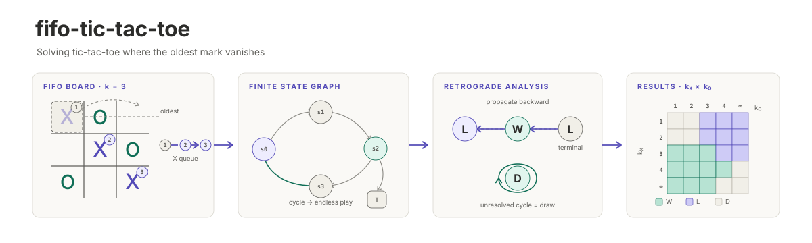

<p align="center"></p>

[English](README.md) | **日本語**

# fifo-tic-tac-toe

古い手が消える○×ゲームを解く．各プレイヤーは盤に最大 `k` 個までしか手を残せず，それを超えて打つと自分の最も古い手が消える (先入れ先出し)．手が消えるので局面が繰り返されうり，対局が終わらないこともあるため，通常の後ろ向き帰納法はそのままでは使えない．このリポジトリは，到達できるすべての局面 (盤面と各プレイヤーの手の古い順) を列挙し，終わらない対局を引き分けとして後退解析で全局面を解く．上限の組 `k_X, k_O ∈ {1, 2, 3, 4, ∞}` のすべてを，最も古い手が消えるタイミングの 3 つの規則それぞれについて解く．ソルバは Rust で書き，対局は [socsim](https://github.com/akitenkrad/rs-social-simulation-tools) で回し，すべての run を [runvault](https://github.com/akitenkrad/rs-runvault) に記録する．

## クイックスタート

安定版の Rust ツールチェーンが必要である．図を描くにはさらに [uv](https://docs.astral.sh/uv/) が要る．リポジトリの直下で実行する．

```bash
# Solve the 25 cap pairs of the main rule (t3) and record a scratch run
cargo run --release -- solve --rule t3 --scratch

# Show one condition: value, distance and optimal first moves
cargo run --release -- show --rule t3 --kx 3 --ko 3 --scratch

# Run the tests
cargo test --release

# Draw the figures and tables from the latest scratch runs
uv sync
uv run fifo-ttt-tools plot --rule t3 --scratch
```

## ドキュメント

- [ルール](docs/rules.ja.md) — 上限，消えるタイミングの 3 規則 `t1`/`t2`/`t3`，対局の終わり方
- [使い方](docs/usage.ja.md) — `fifo-ttt` のサブコマンド，scratch と本番の run，Python のツール
- [解き方](docs/method.ja.md) — 局面の表し方，後退解析，手数の上限，素朴な探索，検査
- [構成](docs/architecture.ja.md) — ソースの構成，socsim での対局，run に記録するもの

## ライセンス

[MIT](LICENSE)
